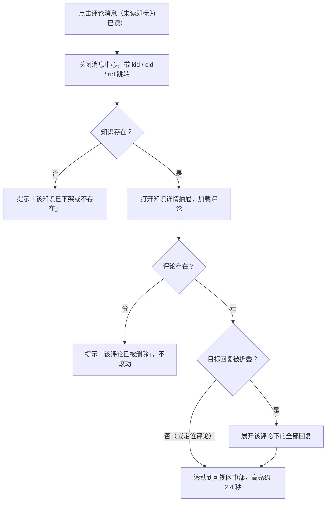

# 消息中心 · 评论消息与知识库定位 PRD

> 涉及页面：
>
> - 顶栏消息下拉：`src/layouts/BasicLayout/Header.tsx`
> - 消息中心弹窗：`src/components/MessageCenter`
> - 培训中心 → 知识库：`src/pages/training/knowledge`，路由 `#/training/knowledge`（线上 `/crane-web/training-center/knowledge-base`）
>
> 状态：待评审，HTML 交互原型已完成
> 日期：2026-10-27
> 在线文档：https://claude.ai/artifact/2XG85dx5SU1C5zfrJVCztj

---

## 一、背景与目标

本次迭代改版顶栏消息中心，新增「评论消息」类型，用户点击评论消息可直接跳到知识库中对应的那条评论或回复。

### 1.1 背景

- 现有顶栏消息下拉只是一列通知，没有分类、没有已读状态；「全部已读」只隐藏角标，刷新后又出现。
- 知识库已支持评论与回复，但用户被回复、或自己贡献的知识收到新评论时没有任何提醒，只能逐条打开知识去翻。

### 1.2 目标

1. 顶栏下拉按消息类型汇总，角标显示真实未读数；「查看更多」进入消息中心弹窗，按类型、日期、已读状态查看全部消息。
2. 新增「评论消息」类型，覆盖「别人回复了我」和「我贡献的知识有新评论」两种场景。
3. 点击评论消息，直接打开对应知识详情，并定位、高亮到具体评论或回复，被折叠的回复自动展开。
4. 原型补齐知识库页面（列表、分类、详情、评论区），结构以测试环境为准。

---

## 二、术语与概念

| 概念 | 说明 |
| --- | --- |
| 消息类型 | 共 3 种：服务系统消息、保养消息、评论消息（本次新增）；顺序即消息中心左侧的顺序 |
| 全部消息 | 消息中心左侧的第一项，包含所有类型的消息 |
| 评论消息·回复 | 别人在知识下回复了当前用户（@当前用户），标题前缀「【回复】」 |
| 评论消息·新评论 | 当前用户作为贡献人的知识收到了新的一级评论，标题前缀「【新评论】」 |
| 评论 / 回复 | 评论 = 知识下的一级留言；回复 = 挂在某条评论下的楼中楼，只有一层，带「@被回复人」 |
| 未读 | 消息未被点击、且未被「全部已读」覆盖；列表前显示红点，计入角标 |
| 定位目标 | 评论消息携带的知识 ID、评论 ID、回复 ID（仅回复类），用于跳转后定位 |

---

## 三、用户与场景

| 角色 | 场景 | 使用功能 |
| --- | --- | --- |
| 知识贡献人 | 自己发布的知识有人提问，需要及时解答 | 新评论消息 → 跳转定位 → 回复 |
| 评论参与者 | 自己提的问题被人回复，想看答案并继续追问 | 回复消息 → 跳转定位 → 继续回复 |
| 设备管理员 | 集中处理保养提醒、服务通知 | 消息中心分类、日期筛选、只看未读、全部已读 |

核心用户故事：

1. 作为知识贡献人，我在铃铛里看到「【新评论】李师傅 电动装载机电池保养指南」，点一下就能看到那条评论并直接回复。
2. 作为提问者，我的评论下有 4 条回复，其中一条是给我的，点消息后即使它被收在「查看更多回复」里，也能直接看到它。

---

## 四、需求范围总览

本次改动 6 个功能点，分布在顶栏和「培训中心 → 知识库」两处。

| # | 功能点 | 位置 | 类型 |
| --- | --- | --- | --- |
| 1 | 消息通知下拉 | 顶栏铃铛 | 改版 |
| 2 | 消息中心弹窗 | 下拉「查看更多」/ 点击分类行 | 新增 |
| 3 | 评论消息类型 | 消息中心、下拉 | 新增 |
| 4 | 知识库列表页 | 培训中心 → 知识库 | 原型补齐（线上已有） |
| 5 | 知识详情与评论区 | 知识库详情抽屉 | 原型补齐（线上已有） |
| 6 | 评论消息跳转定位 | 消息中心 → 知识详情 | 新增 |

不在本次范围：

- 消息的推送渠道（短信、邮件、APP 推送）及消息订阅设置。
- 评论的删除、编辑、点赞、举报及后台审核。
- 服务系统消息、保养消息的点击跳转（本次只标为已读）。

---

## 五、功能需求一：顶栏消息通知下拉

点击铃铛弹出「消息通知」下拉，按消息类型每类一行，只展示每类最新一条。

| 元素 | 规则 |
| --- | --- |
| 铃铛角标 | 显示全部类型的未读总数；为 0 时不显示；超过 99 显示「99+」 |
| 标题栏 | 左侧「消息通知」；右侧蓝色「全部已读」，仅有未读时显示 |
| 分类行 | 圆形分类图标 + 红点（该类有未读时）+ 分类名 + 最新一条的时间；第二行为最新一条的标题，超长省略 |
| 分类行排序 | 按各类最新一条的接收时间倒序；没有消息的类型不显示 |
| 点击分类行 | 关闭下拉，打开消息中心并定位到该分类；不改变已读状态 |
| 全部已读 | 所有消息标为已读 → 关闭下拉 → 提示「已全部标记为已读」 |
| 查看更多 | 底部右对齐蓝色「查看更多 >」，打开消息中心并定位到「全部消息」 |

---

## 六、功能需求二：消息中心弹窗

消息中心为 900px 居中弹窗，标题「消息中心」，右上角关闭；左侧分类、右侧筛选与列表。

### 6.1 左侧分类

- 顺序固定：全部消息、服务系统消息、保养消息、评论消息。
- 每项右侧红底白字显示该分类未读数；为 0 不显示，超过 99 显示「99+」。
- 选中项浅红底、主题红文字；切换分类时保留右侧筛选条件。

### 6.2 筛选栏

| 控件 | 规则 |
| --- | --- |
| 日期区间 | 开始日期 → 结束日期，按自然日包含两端；可只填一端 |
| 重置 | 清空日期区间并取消「只看未读」，不切换分类 |
| 只看未读 | 勾选后列表只展示未读消息，即时生效 |
| 全部已读 | 主题红按钮；将当前分类下的全部未读标为已读（不受日期筛选影响）；当前分类无未读时置灰 |

### 6.3 消息列表

- 按接收时间倒序；每条两行：红点（未读）+ 标题 + 右侧时间；第二行为正文。
- 未读标题加粗深色，已读标题常规字重、浅一级。
- 点击未读消息标为已读；评论消息另有跳转，见第十章。
- 无数据时显示空状态「暂无消息」。

### 6.4 时间显示规则

| 接收时间 | 显示 |
| --- | --- |
| 今天 | 10:01 |
| 昨天 | 昨日 17:13 |
| 前天 | 前天 10:01 |
| 今年更早 | 10月21日 10:01 |
| 往年 | 2025年10月21日 10:01 |

下拉分类行的时间使用同一规则。

---

## 七、功能需求六：评论消息跳转定位

点击评论消息后进入知识库并打开对应详情，目标评论或回复被滚动到可视区中部并高亮。

知识或评论不存在时只提示不定位；新评论类没有 rid，直接定位到一级评论。

| 规则 | 说明 |
| --- | --- |
| 跳转地址 | `/training/knowledge?kid=知识ID&cid=评论ID&rid=回复ID`；rid 仅回复类携带 |
| 参数处理 | 页面读取参数后立即从地址中清除，保证再次点击同一条消息仍会触发定位 |
| 自动展开 | 目标回复不在默认展示的前 2 条时，展开该评论下全部回复 |
| 排序 | 保持默认「最新回复」，不因定位而切换 |
| 滚动时机 | 等抽屉滑入动画结束（约 300ms）再平滑滚动，目标居中 |
| 高亮 | 浅橙底色，保持后淡出，共约 2.4 秒 |

---

## 八、异常与边界情况

| 情况 | 处理 |
| --- | --- |
| 知识已下架或不存在 | 提示「该知识已下架或不存在」，停留在知识库列表页 |
| 评论或回复已删除 | 正常打开详情，提示「该评论已被删除」，不滚动 |
| 已在知识库页，再点另一条评论消息 | 详情切换到新知识并重新定位 |
| 重复点击同一条消息 | 每次都重新打开并定位（读取参数后立即清除） |
| 已读的评论消息 | 仍可点击跳转 |
| 无任何消息 | 角标不显示；下拉无分类行，只有「查看更多」；消息中心显示「暂无消息」 |
| 评论 / 回复超 100 字 | 输入框限制无法继续输入 |
| 昵称或知识名称过长 | 消息标题单行省略，正文完整换行 |

---

## 九、验收标准与原型对照

原型已在 mysany-pc 实现，以下条目均已在原型中走通。

- [ ] 角标数 = 全部未读数；点击一条未读后角标与左侧分类未读数同时减 1
- [ ] 下拉「全部已读」后角标消失，消息中心所有红点消失
- [ ] 消息中心「全部已读」只作用于当前分类
- [ ] 时间按 6.4 规则显示今天 / 昨日 / 前天 / 日期
- [ ] 评论消息标题为「【回复】/【新评论】+ 昵称 + 知识名称」，正文与知识库中的评论一致
- [ ] 点击「【回复】Wang Lei 起重机吊装作业安全规范」：目标回复原本折叠，跳转后自动展开、滚动到可视区中部并高亮
- [ ] 点击「【新评论】李师傅 电动装载机电池保养指南」：定位到一级评论
- [ ] 停在知识库详情时从铃铛进入另一条评论消息，详情切换并定位
- [ ] 在详情中发表评论 / 回复后，评论数 +1，新内容出现在对应位置

原型说明：原型数据在内存中，刷新后已读状态、新评论、点赞会恢复初始值；示例知识与评论为业务化的演示数据，非测试环境原样。

待确认：

- 服务系统消息、保养消息点击后是否需要跳转（如保养消息跳设备保养）？
- 消息保留时长及列表是否分页 / 滚动加载？
- 一级评论下的回复（未 @贡献人）是否也要通知贡献人？
